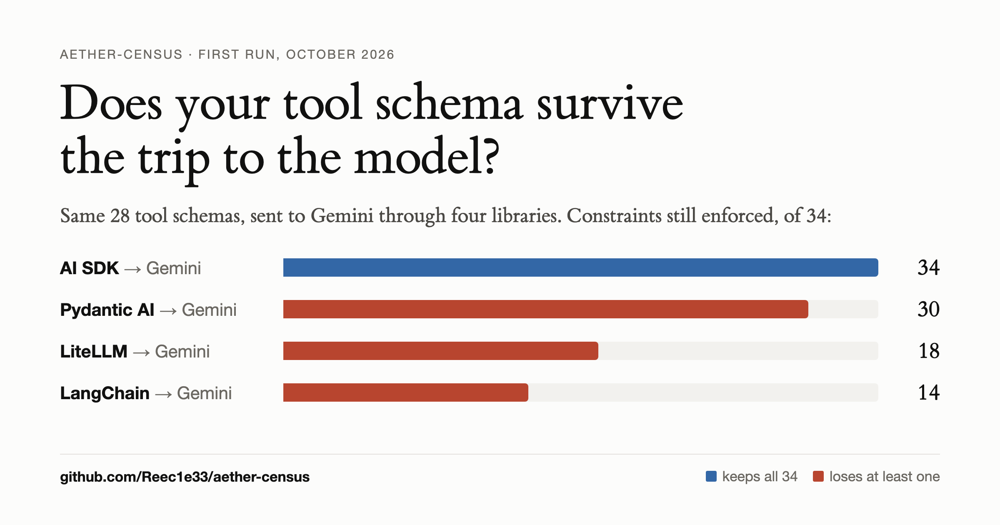

# aether-census

[](https://github.com/Reec1e33/aether-census/actions/workflows/ci.yml)
[](LICENSE)

Does your tool schema survive the trip to the model?

[](https://reec1e33.github.io/aether-census/deck.html)

You write one JSON Schema for a tool, then hand it to an SDK or gateway that turns it into a request for OpenAI, Anthropic, Gemini, Bedrock, and so on. Somewhere in that translation, parts of the schema can quietly disappear. Nothing errors, nothing gets logged, and nothing on the provider side stops the model from sending arguments your schema was supposed to forbid.

This repo measures that. It runs 28 tool schemas through 19 library + provider combinations, catches each request before it leaves the machine, and checks whether the schema that went out still enforces what the original did.

## What I found (first run, October 2026)

| Library → provider | Constraints still enforced | Notes |
| --- | --- | --- |
| AI SDK → all 8 providers | 34 / 34 | Sends the schema through unchanged, including to Gemini (`parametersJsonSchema`). |
| LiteLLM → OpenAI, Groq, Mistral, xAI | 34 / 34 | |
| Pydantic AI → Anthropic | 34 / 34 | |
| Pydantic AI → OpenAI | 34 / 34 | But one schema becomes impossible to satisfy (below). |
| LiteLLM → Anthropic, Bedrock | 33 / 34 | Drops `dependentRequired`. |
| Pydantic AI → Gemini | 30 / 34 | Drops exclusive bounds; moves `format` into the description as a hint. |
| LiteLLM → Gemini | 18 / 34 | Drops `const`, `multipleOf`, `uniqueItems`, `not`, `oneOf`, `allOf`, `additionalProperties`, `dependentRequired`, exclusive bounds, `format: email`, and every constraint on a nullable field written as a type array (`["string", "null"]`). |
| LangChain → Gemini | 14 / 34 | Drops `pattern`, `minimum`/`maximum`, `minLength`/`maxLength`, `minItems`/`maxItems`, `format`, `const`, and more. Six schemas also change shape (below). |

"Constraints still enforced" means: for each of 34 test cases, a value the original schema rejects is still rejected by the schema that was actually sent. Full table, per constraint: [`results/summary.md`](results/summary.md). There's also a [short deck with the results](https://reec1e33.github.io/aether-census/deck.html) (source: [`docs/deck.html`](docs/deck.html)); its charts are filled from `results/results.json` by `harness/deck_data.py`.

Dropping is the obvious failure. The sneakier one is a schema that comes out *stricter or broken*, so a model that follows it can't send a value you'd accept:

- **Pydantic AI → OpenAI** adds `properties: {}` and `additionalProperties: false` to a free-form object that has `minProperties: 1`. Nothing can satisfy that.
- **LangChain → Gemini** turns `oneOf`, free-form objects, and nullable type arrays into `STRING`, and marks optional nested fields as required. A model that follows it has to make up a value for a field you left optional.

One more that the census ran into by accident: **LiteLLM's Gemini path rewrites the tool definition you pass in, in place** ([LiteLLM #46921](https://github.com/BerriAI/litellm/issues/46921)). If you then send the same dict to another provider, for example as a Router fallback, that provider gets the Gemini version: `"type": "object"` inside each `allOf` branch, `nullable: true` in place of a `null` branch, and no `additionalProperties`. It got into the first version of these results too (see [Corrections](#corrections)).

All of it is reported upstream. Most was already known: [LiteLLM #43325](https://github.com/BerriAI/litellm/issues/43325), [#41913](https://github.com/BerriAI/litellm/issues/41913) and [#46921](https://github.com/BerriAI/litellm/issues/46921); [langchain-google #1725](https://github.com/langchain-ai/langchain-google/issues/1725), [#1998](https://github.com/langchain-ai/langchain-google/issues/1998) and [#1622](https://github.com/langchain-ai/langchain-google/issues/1622). Two cases had no issue and are now filed, each with an offline reproduction: Pydantic AI's `minProperties` + `additionalProperties: false` ([pydantic-ai #11419](https://github.com/pydantic/pydantic-ai/issues/11419)), and LangChain turning type arrays such as `["integer", "null"]` into `STRING` ([langchain-google #2085](https://github.com/langchain-ai/langchain-google/issues/2085)).

## How it works

1. **Fixtures.** Each file in [`fixtures/`](fixtures/) is a tool schema, some arguments it must accept, and for each constraint under test, an argument object that breaks only that constraint. The loader proves that last part: the bad object fails against the schema, then passes once that one constraint is removed. So a case can't fail for some unrelated reason.
2. **Capture.** Each library builds a real request for every fixture. The AI SDK gets a custom `fetch`; the Python libraries get their `httpx`/`httpx2` transports replaced and sockets blocked. Nothing reaches a provider and no API keys are involved.
3. **Judge.** Find the tool schema in the request body, convert Gemini's OpenAPI subset to JSON Schema where needed, and run the fixture's examples against it with Ajv.

## What this does and doesn't tell you

- It measures what the **library sends**. A schema that goes out intact can still be ignored or rejected by the provider; that's the next step and needs API keys.
- Some drops are the library working around a provider that doesn't support a keyword. That's still worth knowing, because nothing tells you it happened (LangChain does log a warning for some keywords).
- `format` is only an annotation in JSON Schema 2020-12 unless a validator opts in. I count it because some providers enforce formats in strict mode.
- The headline table uses one model per provider. Every path was also re-run with two or three more models each, including current ones (GPT-5.2, Claude Sonnet 5.5 and Opus 5.5, Gemini 3.x): 72 library and model pairs in all. Only one score moved: LiteLLM → Bedrock keeps `additionalProperties: false` for Claude Sonnet 4.5 and drops it for Claude Sonnet 5.5, Nova Pro, and Mistral Large. Per model: [`results/models/by-model.md`](results/models/by-model.md).

## Run it yourself

Needs Node 22+, pnpm, and Python (CI uses 3.14).

```sh
pnpm install
./harness/run.sh          # captures everything again, then writes results/
./harness/run.sh --check  # same, plus a check that target order changes nothing
pnpm test
```

`run.sh` builds one virtualenv per Python library from the lockfiles in [`harness/requirements/`](harness/requirements/), because LiteLLM and Pydantic AI need different major versions of `openai`. It takes about half a minute.

You don't have to run it to check it. On every push, [CI](https://github.com/Reec1e33/aether-census/actions/workflows/ci.yml) runs `./harness/run.sh --check` from a clean checkout: every library and model, sockets blocked, then the Python captures again in reverse target order. It fails if a single request or result differs from what's committed. A [weekly job](https://github.com/Reec1e33/aether-census/actions/workflows/latest.yml) does the same with the newest release of each library and fails if any score changes.

## Contributing

The most useful thing is a fixture from a real failure you've hit. A new library to capture is next. See [CONTRIBUTING.md](CONTRIBUTING.md). Notes and open questions are in [docs/research-plan.md](docs/research-plan.md).

## Corrections

**2026-10-26.** The first version of these results (2026-10-22) said LiteLLM broke `allOf` and `nullable` schemas and dropped `additionalProperties: false` for Groq, Mistral, xAI, and Bedrock. It doesn't. The harness reused one copy of each fixture across targets, and LiteLLM's Gemini path, which ran first, rewrote it in place, so every later target got the Gemini version. Each target now gets a fresh copy, and CI re-runs the Python captures in reverse target order to catch any leak like this. The judge also had a bug: it didn't read the `any_of` spelling that LangChain sends to Gemini. Fixing it moves LangChain → Gemini from 13 to 14.

## Background

This repo used to be AetherAI, a SpartaHack X project that Tanzil Zubair Bin Zaman and I built in February 2025. It rewrote your prompt with GPT-4 and showed both answers side by side, along with a "time saved" number that was really just the ratio of the two answer lengths times 20 seconds. That number didn't measure anything. The old code is at the [`spartahack-2025`](https://github.com/Reec1e33/aether-census/tree/spartahack-2025) tag.

## License

MIT
